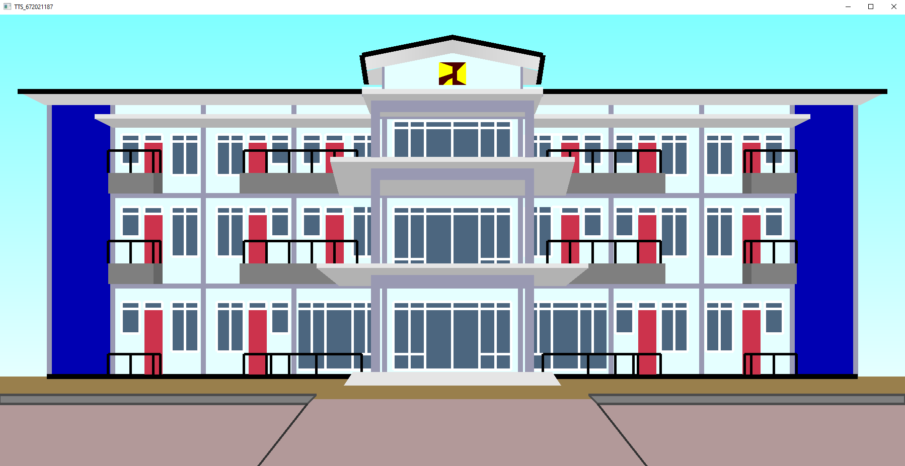

# Computer Graphics - 2D Dormitory Visualization

A 2D computer graphics project that recreates the front facade of a faculty dormitory building using **C++, and OpenGL**.

This project was developed as part of a Computer Graphics course to explore fundamental graphics programming concepts through a visual representation of an architectural structure.

## Preview

  

## Project Overview

The application presents a front-facing 2D visualization of a dormitory building, illustrating its architectural layout through geometric shapes, colors, and repeated structural elements.

The visualization includes building floors, windows, balconies, the central entrance, the roof structure, and surrounding ground elements.

## Built With

- **C++** — Core programming language
- **OpenGL** — Computer graphics rendering

## Key Features

- **Architectural Visualization** — A 2D representation of a faculty dormitory facade.
- **Geometric Drawing** — Building structures and architectural details represented using graphical shapes.
- **Color Composition** — Different colors used to distinguish architectural elements.
- **Structural Repetition** — Repeated windows, balconies, and facade elements arranged across the building.
- **Coordinate-Based Design** — Objects positioned to create a balanced, symmetrical composition.

## Getting Started

### Prerequisites

Before running the project, make sure you have:

- A C++ compiler
- OpenGL development libraries
- Code::Blocks or another compatible C++ development environment

The required graphics libraries and compiler settings depend on the original project configuration.

### Running the Project

1. Clone or download this repository.
2. Open `TTS_672021187.cbp` in Code::Blocks.
3. Check that the required compiler and OpenGL libraries are configured.
4. Build and run the application.

If you use a different development environment, configure the project according to its compiler and graphics library requirements.

## Learning Objectives

Through this project, I explored:

- Fundamental concepts of computer graphics.
- Drawing and positioning geometric shapes.
- Applying colors to visual elements.
- Organizing graphical objects into a complete architectural scene.
- Translating a real-world structure into a 2D computer-generated representation.

## Project Background

This project was created as an mid-test academic assignment for a Computer Graphics course. It represents an early exploration of graphics programming using C++ and OpenGL.

## Author

**Erik Maulana Hardianto**

Computer Science Graduate | Aspiring Backend Developer

